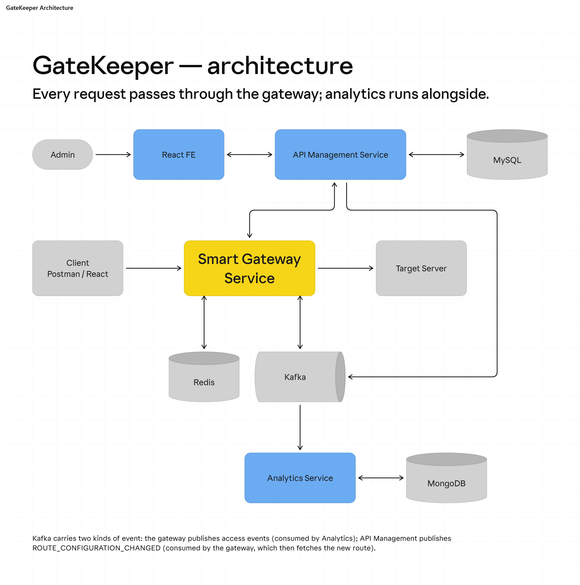

# GateKeeper

**A self-built API gateway on Spring Boot microservices — dynamic routing, rate limiting and asynchronous analytics.**


GateKeeper sits in front of backend services. Every client request passes through the gateway, which authenticates
it, applies per-route policies and forwards it to the target service. Routes are managed through a separate service
and reach the gateway at runtime without a restart, while every request is recorded asynchronously for analytics.

## Architecture



| Service | Port | Responsibility | Data store |
|---|---|---|---|
| **Smart Gateway** | 8080 | Single entry point: authentication, policies, routing, proxying | Redis |
| **API Management** | 8081 | Users, routes and gateway policies; publishes configuration changes | MySQL |
| **Analytics** | 8082 | Consumes access events and serves API-usage analytics | MongoDB |

## Features

| | Feature |
|---|---|
| ⏳ | Dynamic API routing |
| ⏳ | Reverse proxying |
| ⏳ | Authentication and route-level authorization |
| ⏳ | Redis-based rate limiting |
| ⏳ | Correlation IDs across services |
| ⏳ | Route-level timeouts |
| ⏳ | Idempotent `POST` request processing |
| ⏳ | Request path and header transformation |
| ⏳ | Asynchronous access-event publishing through Kafka |
| ⏳ | MySQL for structured configuration data |
| ⏳ | MongoDB for high-volume, flexible analytics events |
| ⏳ | Filters and interceptors |
| ⏳ | Global exception handling |
| ⏳ | AOP-based administrative auditing |
| ⏳ | Separation of the request-processing path from background processing |

✅ done · 🚧 in progress · ⏳ planned

## Design decisions

- **Routes live in the gateway's memory.** Routing a request needs no database call, keeping the request path fast.
- **Configuration is versioned.** Every route change is saved as a new version in MySQL rather than overwriting the
  old one.
- **Events signal, the gateway fetches.** On a change, API Management publishes `ROUTE_CONFIGURATION_CHANGED`; the
  gateway then fetches the latest route from API Management and swaps its in-memory copy. Duplicate or out-of-order
  events can't leave it with a stale route.
- **Analytics never slows a request.** The gateway publishes access events to Kafka without waiting; the Analytics
  service stores them separately.
- **A store per workload.** MySQL for structured, relational configuration; MongoDB for high-volume, loosely
  structured events; Redis for fast, shared rate-limit counters.

## Getting started

**Prerequisites:** JDK 17+

Each service runs on its own. From a service folder:

```bash
./mvnw spring-boot:run        # Windows: .\mvnw spring-boot:run
```

Health check:

```bash
curl http://localhost:8080/health
```

```json
{"serviceName":"Smart Gateway Service","serviceDescription":"Custom API gateway for routing, security and traffic management","appStatus":"UP"}
```

## Tech stack

Java 17 · Spring Boot 4.1 (Web MVC, Security / OAuth2 Resource Server, Data JPA, Data MongoDB, Data Redis, Kafka) ·
MySQL · MongoDB · Redis · Apache Kafka · Maven · Lombok

## Project structure

```
GateKeeper/
├── smart-gateway-service/     # dev.gatekeeper.gateway
├── api-management-service/    # dev.gatekeeper.management
└── analytics-service/         # dev.gatekeeper.analytics
```
